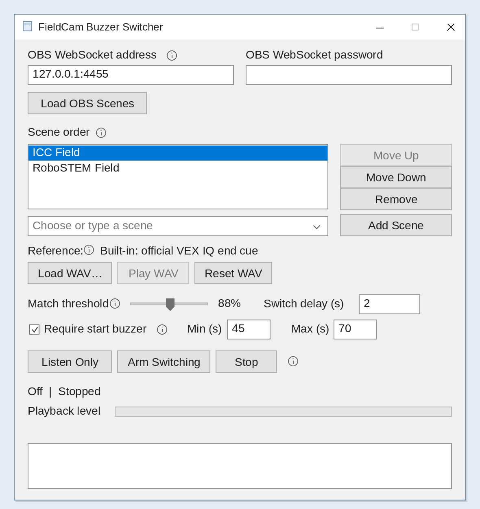

<h1 align="center">FieldCam Buzzer Switcher</h1>
<p align="center">Switch OBS field cameras when a VEX IQ match ends.</p>
<p align="center"><a href="https://github.com/robostem-foundation/buzzer-switcher/releases"><strong>Windows releases</strong></a> · <a href="#quick-start">Quick start</a> · <a href="#build-from-source">Build from source</a></p>
<p align="center"><sub>Windows 10/11 (x64) · OBS Studio 28 or later</sub></p>

<p align="center">
  
</p>
<p align="center"><sub>Layout preview, not a screenshot from Windows.</sub></p>

## Quick start

1. Download and extract the Windows ZIP. Open **FieldCam Buzzer Switcher.exe**. There's no installer. The EXE is unsigned.
2. In OBS, open **Tools → WebSocket Server Settings** and enable the server. Keep authentication on. If OBS and FieldCam run on the same PC, use `127.0.0.1:4455` in FieldCam and enter the WebSocket password shown by OBS.
3. Click **Load OBS Scenes**. Add your field scenes in match order. For two alternating fields, your list might be `ICC Field → RoboSTEM Field`. FieldCam wraps from the last scene back to the first.
4. Click **Listen Only** before a full practice match. Look for **Start sound matched**, then **End sound matched**. Listen Only does not switch scenes.
5. Put a field scene on OBS Program and click **Arm Switching** before the next start buzzer. Test it off-air first. OBS uses its current scene transition.

> [!TIP]
> If the level meter stays flat, check where Tournament Manager plays its sound. FieldCam listens to the default Windows playback device on the PC running FieldCam, not the OBS audio mixer or a microphone.

## What triggers a switch?

| Setting | Default |
| --- | --- |
| Require start buzzer | On |
| Time from start to end | 45–70 seconds |
| Delay after the end buzzer | 2 seconds |
| Match threshold | 88% |

An end buzzer outside the match window won't switch scenes. If you arm midway through a match, FieldCam waits for the next start buzzer. It also skips the switch if the live scene isn't in your list, and cancels if a different scene is live when the delay ends.

FieldCam follows your scene order. It can't identify fields or tell Skills apart from teamwork if they use the same sounds. Hit **Stop** during breaks, Skills, or when matches don't follow the order you set.

## What it connects to

FieldCam processes audio on your PC and doesn't record it. It doesn't connect to Tournament Manager or need a TM API key. It loads local `Start.wav` and `Stop.wav` from Tournament Manager when available and uses built-in sound fingerprints otherwise. No original buzzer recordings are included. You can load a custom end WAV.

FieldCam keeps one OBS WebSocket connection open across switches. It saves your scene order and timing on exit, but not your password or armed state.

## Build from source

Use Go 1.24 or later. From PowerShell:

```powershell
go test ./...
$env:GOOS = 'windows'
$env:GOARCH = 'amd64'
$env:CGO_ENABLED = '0'
go build -trimpath -ldflags="-H=windowsgui -s -w" -o "FieldCam Buzzer Switcher.exe" ./app
```

The tests cover buzzer timing, scene order, and OBS WebSocket behavior. Audio capture uses Windows WASAPI loopback.

An independent RoboSTEM Foundation project. Not affiliated with VEX Robotics or OBS Studio.
